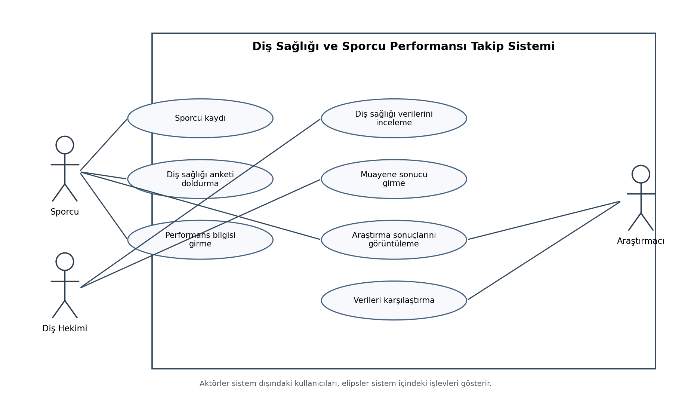
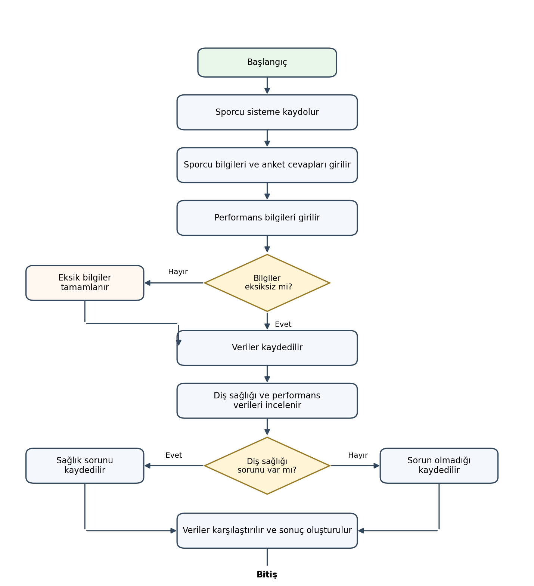
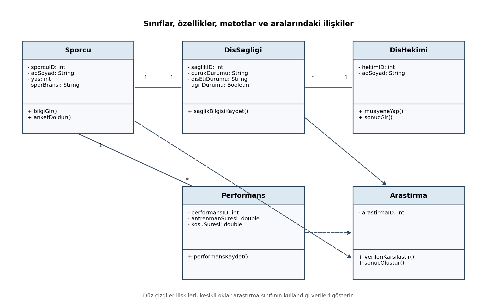

# Diş Sağlığı ve Sporcu Performansı

Bu proje, atletizm ve benzeri fiziksel performans gerektiren spor dallarındaki sporcularda ağız ve diş sağlığı durumu ile sportif performans göstergeleri arasındaki ilişkiyi incelemeyi amaçlar.

## UML Diyagramları

- **Use Case Diagram:** Sistemin aktörlerini ve bu aktörlerin gerçekleştirdiği işlemleri gösterir.
- **Activity Diagram:** Sporcu kaydından veri karşılaştırmasına kadar araştırma sürecinin akışını gösterir.
- **Class Diagram:** Sistemin temel sınıflarını, özelliklerini, metotlarını ve ilişkilerini gösterir.

## Dosyalar

### Görseller
- `use-case-diagram.png`
- `activity-diagram.png`
- `class-diagram.png`

### PlantUML kaynakları
- `use-case-diagram.puml`
- `activity-diagram.puml`
- `class-diagram.puml`

## GitHub Deposu

https://github.com/ismailkirac/dis-sagligi-sporcu-performansi
## UML Diyagramları

### 1. Use Case Diyagramı

### 2. Activity Diyagramı

### 3. Class Diyagramı

